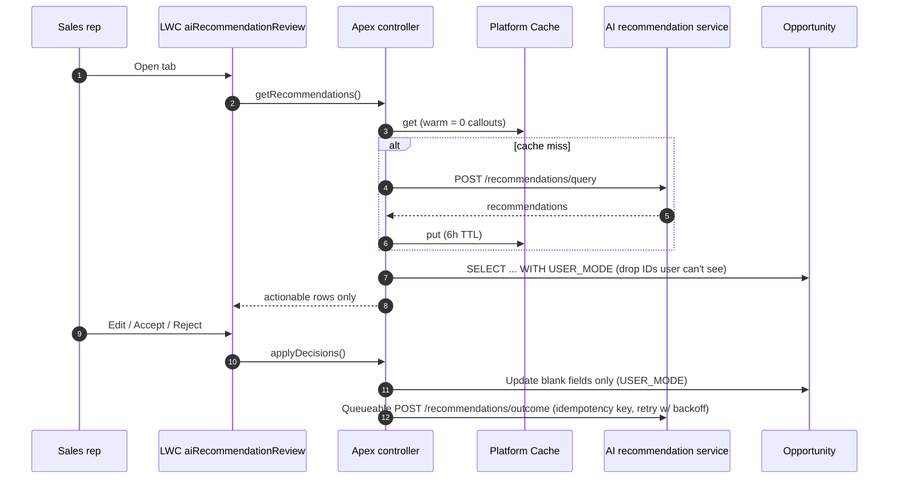

# Human-in-the-Loop AI Recommendations for Salesforce

> An LWC + Apex review console where sales reps **accept, edit, or reject** LLM-generated field
> suggestions (from call transcripts) — with record-access enforcement, field protection,
> Platform Cache, and an asynchronous feedback loop back to the AI service.


Clean-room showcase of a pattern I use professionally — no employer code or data.

---

## Why human-in-the-loop?

Auto-writing AI output into revenue fields (deal type, forecast size) is risky: one hallucinated number
skews a forecast. This design keeps a person accountable for every change while still removing the
manual research effort.

## Architecture



## Design decisions

| Concern | Decision |
|---|---|
| **Data ownership** | Recommendations live in the AI service → no staging custom objects in the org |
| **Security** | IDs from the service are re-queried `WITH USER_MODE`; DML runs in `AccessLevel.USER_MODE`; Named Credential handles auth |
| **Protect human data** | Populated Type/Description and positive Forecast are never offered or overwritten |
| **Confidence gating** | Numeric fields require `HIGH` confidence to be editable |
| **Blast radius** | Apply limited to 10 Opportunities per action |
| **Performance** | Org Platform Cache (6h TTL) → warm reload makes zero callouts |
| **Feedback loop** | Decisions sent asynchronously with SHA-256 idempotency keys; retries with backoff |
| **UX** | Rows disappear when nothing actionable remains; Opportunity records are never deleted |

## Repository layout

```
force-app/main/default/
  classes/  AiRecommendationController · RecommendationClient · RecommendationCache
            RecommendationOutcomeJob · AiRecommendationControllerTest
  lwc/      aiRecommendationReview
  objects/  AI_Review_Settings__c · Opportunity.Forecasted_Users__c
```

## Run it

```bash
sf project deploy start --target-org dev
sf apex run test --class-names AiRecommendationControllerTest --target-org dev --code-coverage
```

Create a Named Credential `AI_Review_Service` for your recommendation API and an Org cache partition
named `AiReview` (*Setup → Platform Cache*), then add the component to a Lightning tab.

## License

MIT © Naman G Shetty
